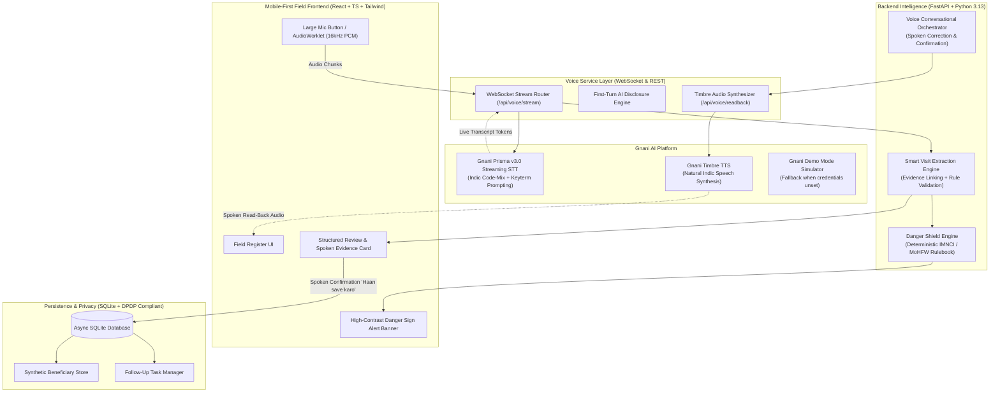
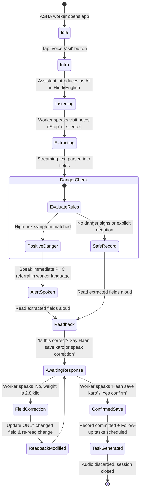

# ASHA Saathi – Architecture & Technical Specification

## System Overview

ASHA Saathi is an AI voice field register built for Accredited Social Health Activists (ASHA workers) in India. It converts unconstrained, Indic code-mixed speech dictation into structured public-health visit records with zero typing, performs real-time deterministic danger sign triage, and maintains follow-up task registers.

---

## 1. High-Level Architecture Diagram (Mermaid)

---

## 2. Voice Session State Machine

---

## 3. Core Component Roles

1. **Gnani Service Layer (`app/services/gnani_service.py`)**:
   - Manages Prisma streaming STT WebSockets and Timbre synthesis REST APIs.
   - Inject official healthcare keyterms (`IFA goli`, `ANC`, `HBNC`, `Pentavalent`, `BCG`, `pasli chalna`, `garam bukhar`).
   - Labeled Demo Mode: Provides high-fidelity offline simulation without mocking fake API responses.
2. **Smart Extraction Engine (`app/services/extraction_service.py`)**:
   - Extracts: `beneficiary_id`, `visit_type`, `visit_date`, `weight_kg`, `vaccinations_due`, `vaccinations_completed`, `anc_pnc_details`, `next_visit_date`.
   - Links every field to exact spoken source evidence with confidence score.
   - Enforces zero hallucination: preserves missing fields as `null` and prompts worker for voice clarification.
3. **Danger Shield Engine (`app/services/danger_shield.py`)**:
   - Separate, deterministic, rule-based danger sign detector.
   - Versioned vocabulary (`V1.2`) mapped to MoHFW and IMNCI protocols.
   - Windowed negation analysis (`nahi hai`, `no fever`, `theek se pee raha`) preventing false positives.
   - Generates emergency spoken prompts in Hindi and English.
4. **Voice Orchestrator (`app/services/voice_orchestrator.py`)**:
   - Generates first-turn AI disclosure.
   - Constructs natural spoken read-back sentences.
   - Modifies ONLY target field during voice corrections ("No, weight is 2.8 kg").
   - Enforces spoken confirmation before database insertion.
